# 图表目录

所有主题、尺寸和成品状态见 [manifest.json](manifest.json)。

## Code Time

Code Time 累计时长，对应 Coding 分类。

状态 ready，范围 all-time。

[SVG](badges/coding/all-time.svg) · [PNG](badges/coding/all-time.png)

## AI Code Time

AI Code Time 累计时长，对应 AI Coding 分类。

状态 ready，范围 all-time。

[SVG](badges/ai-coding/all-time.svg) · [PNG](badges/ai-coding/all-time.png)

## Total Activity

Total Activity 累计时长，包含所有活动分类与 Other 语言。

状态 ready，范围 all-time。

[SVG](badges/total-activity/all-time.svg) · [PNG](badges/total-activity/all-time.png)

## Codex Vscode

编辑器来源 Codex Vscode 的累计时长。

状态 ready，范围 all-time。

[SVG](badges/editors/Q29kZXggVnNjb2Rl/all-time.svg) · [PNG](badges/editors/Q29kZXggVnNjb2Rl/all-time.png)

## VS Code

编辑器来源 VS Code 的累计时长。

状态 ready，范围 all-time。

[SVG](badges/editors/VlMgQ29kZQ/all-time.svg) · [PNG](badges/editors/VlMgQ29kZQ/all-time.png)

## Codex CLI

编辑器来源 Codex CLI 的累计时长。

状态 ready，范围 all-time。

[SVG](badges/editors/Q29kZXggQ0xJ/all-time.svg) · [PNG](badges/editors/Q29kZXggQ0xJ/all-time.png)

## Activity overview

累计全部活动、Coding 与 AI Coding 分类时长。

状态 ready，范围 all-time。

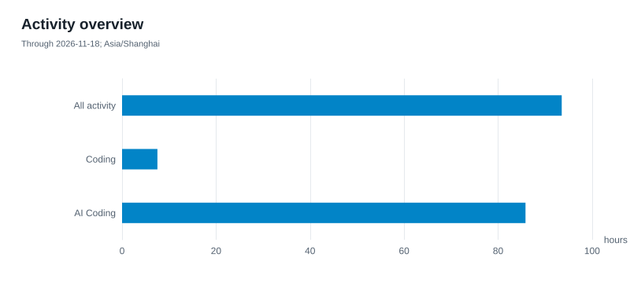

[SVG](charts/overview/all-time.light.wide.svg) · [PNG](charts/overview/all-time.light.wide.png)

## Recent activity summary

最近 30 天已取得记录的总活动、按记录天数计算的日均、活跃天数和最高活动日。

状态 ready，范围 last-30-days。

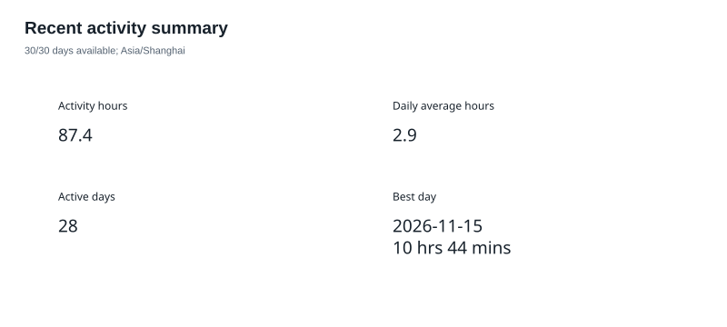

[SVG](charts/summary/last-30-days.light.wide.svg) · [PNG](charts/summary/last-30-days.light.wide.png)

## Languages

按累计活动小时排列，显示前十项。

状态 ready，范围 all-time。

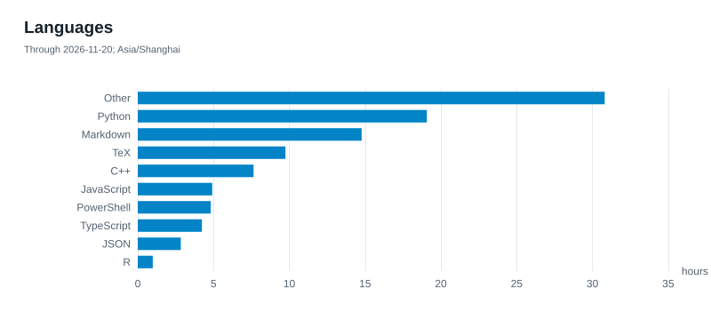

[SVG](charts/languages/all-time.light.wide.svg) · [PNG](charts/languages/all-time.light.wide.png)

## Editors

按累计活动小时排列，显示前十项。

状态 ready，范围 all-time。

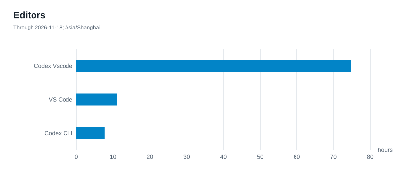

[SVG](charts/editors/all-time.light.wide.svg) · [PNG](charts/editors/all-time.light.wide.png)

## Activity categories

按累计活动小时排列，显示前十项。

状态 ready，范围 all-time。

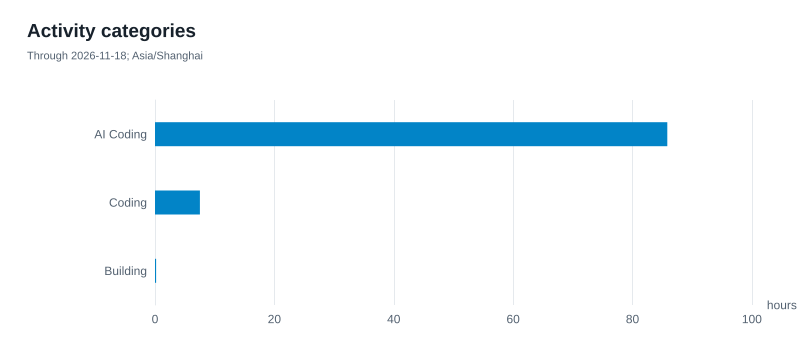

[SVG](charts/categories/all-time.light.wide.svg) · [PNG](charts/categories/all-time.light.wide.png)

## All projects

按累计活动小时排列，展示 WakaTime 返回的全部项目。

状态 ready，范围 all-time。

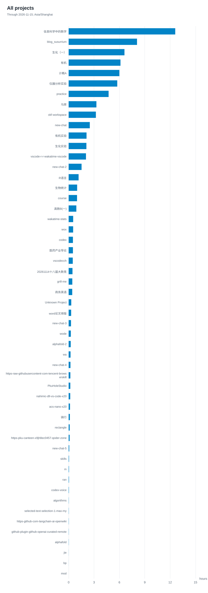

[SVG](charts/projects/all-time.light.wide.svg) · [PNG](charts/projects/all-time.light.wide.png)

## Operating systems

按累计活动小时排列，显示前十项。

状态 ready，范围 all-time。

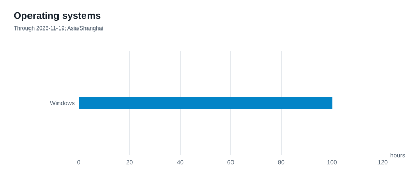

[SVG](charts/operating-systems/all-time.light.wide.svg) · [PNG](charts/operating-systems/all-time.light.wide.png)

## Daily activity

每日全部活动小时；缺失日期保留间隔。

状态 ready，范围 last-30-days。

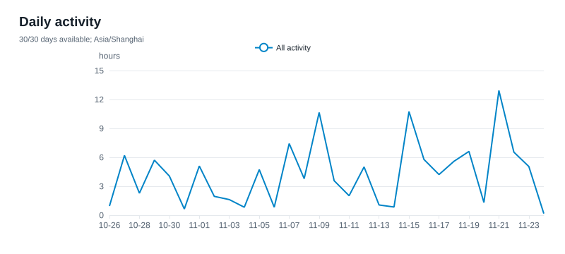

[SVG](charts/daily/last-30-days.light.wide.svg) · [PNG](charts/daily/last-30-days.light.wide.png)

## Coding and AI Coding

每日 Coding 与 AI Coding 分类小时。

状态 ready，范围 last-30-days。

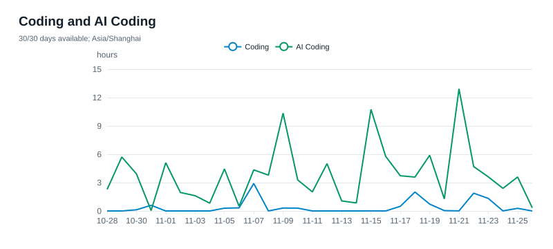

[SVG](charts/coding-trend/last-30-days.light.wide.svg) · [PNG](charts/coding-trend/last-30-days.light.wide.png)

## Activity by weekday

最近 30 天各星期的平均活动小时，分母仅含已取得数据的日期。

状态 ready，范围 last-30-days。

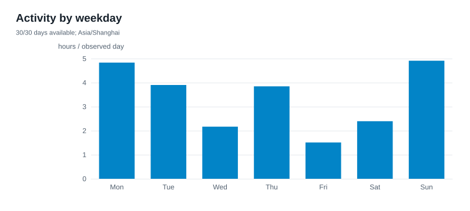

[SVG](charts/weekdays/last-30-days.light.wide.svg) · [PNG](charts/weekdays/last-30-days.light.wide.png)

## 2026 activity calendar

每天的全部活动小时，空白表示尚无已验证记录。

状态 ready，范围 2026。

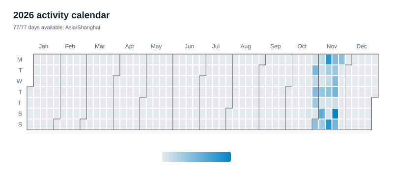

[SVG](charts/calendar/2026.light.wide.svg) · [PNG](charts/calendar/2026.light.wide.png)

## Activity by hour

已取得的日内活动区间按本地小时切分；重叠区间沿用来源统计口径。

状态 ready，范围 recent-hours。

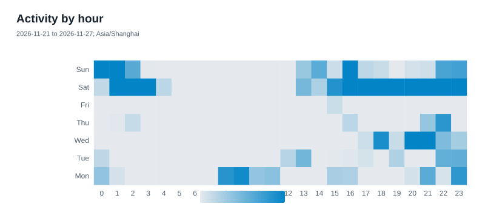

[SVG](charts/hours/recent-hours.light.wide.svg) · [PNG](charts/hours/recent-hours.light.wide.png)

## Code additions and deletions

来源报告的 AI 与人工代码新增、删除行数。

状态 ready，范围 all-time。

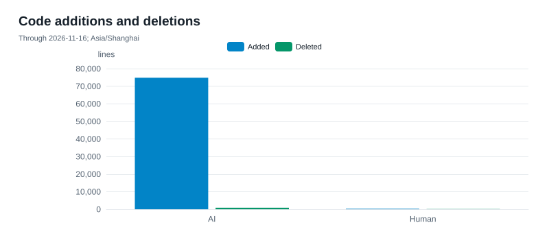

[SVG](charts/code-changes/all-time.light.wide.svg) · [PNG](charts/code-changes/all-time.light.wide.png)

## AI model code changes

按模型报告的指标排行。

状态 ready，范围 all-time。

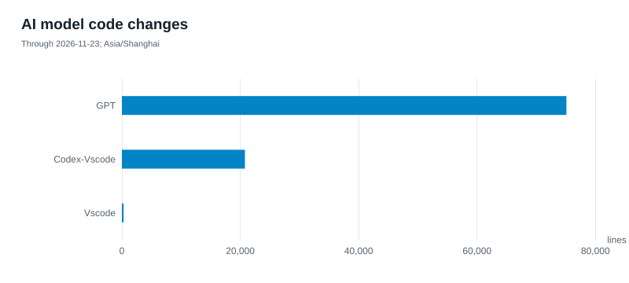

[SVG](charts/models/all-time.light.wide.svg) · [PNG](charts/models/all-time.light.wide.png)

## Estimated AI model cost

按来源 Token 价格估算的美元费用。

状态 ready，范围 all-time。

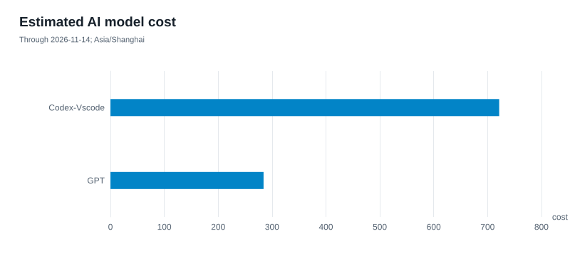

[SVG](charts/model-costs/all-time.light.wide.svg) · [PNG](charts/model-costs/all-time.light.wide.png)

## AI model input tokens

最近 30 天每日汇总中可用的模型 Token 累计量。

状态 ready，范围 last-30-days。

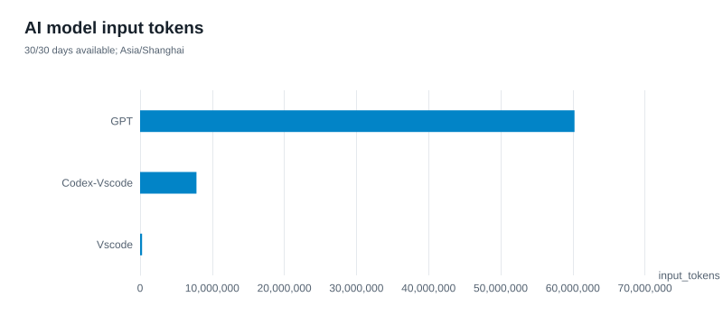

[SVG](charts/model-input-tokens/last-30-days.light.wide.svg) · [PNG](charts/model-input-tokens/last-30-days.light.wide.png)

## AI model output tokens

最近 30 天每日汇总中可用的模型 Token 累计量。

状态 ready，范围 last-30-days。

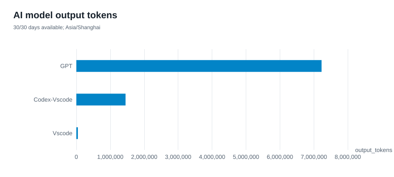

[SVG](charts/model-output-tokens/last-30-days.light.wide.svg) · [PNG](charts/model-output-tokens/last-30-days.light.wide.png)

## AI tokens per day

每日输入与输出 Token，缺失字段保留空白。

状态 ready，范围 last-30-days。

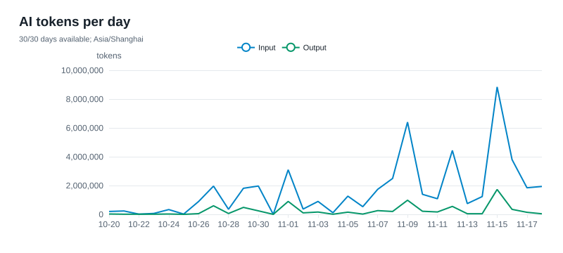

[SVG](charts/token-trend/last-30-days.light.wide.svg) · [PNG](charts/token-trend/last-30-days.light.wide.png)

## AI sessions and prompts

每日会话数与提示次数；跨日会话分别按当天来源统计。

状态 ready，范围 last-30-days。

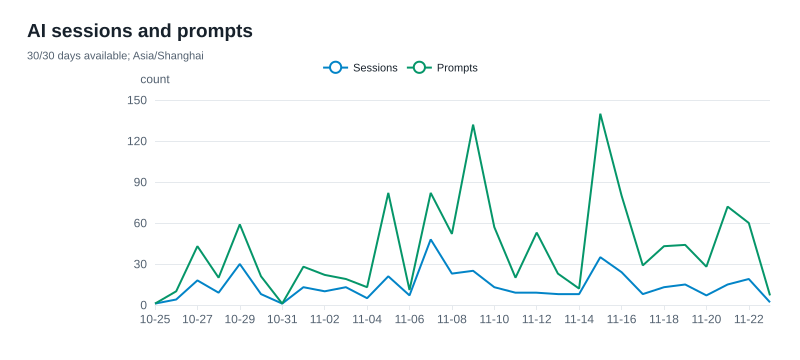

[SVG](charts/sessions/last-30-days.light.wide.svg) · [PNG](charts/sessions/last-30-days.light.wide.png)

## AI prompt length

每日提示平均字符数及按会话汇总的中位数。

状态 ready，范围 last-30-days。

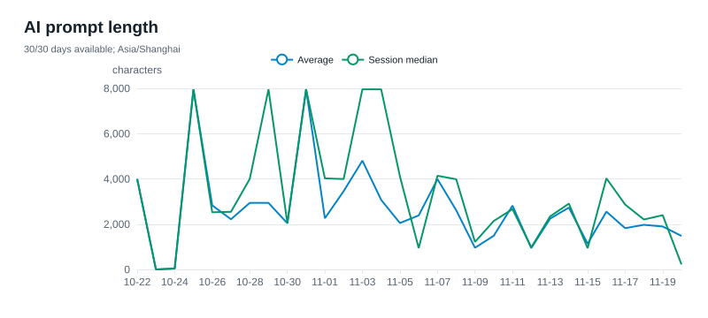

[SVG](charts/prompt-length/last-30-days.light.wide.svg) · [PNG](charts/prompt-length/last-30-days.light.wide.png)

## Daily programming goal

WakaTime 中实际启用的每日 3 小时目标，范围包含全部项目、语言和编辑器及每天。

状态 ready，范围 current-period。

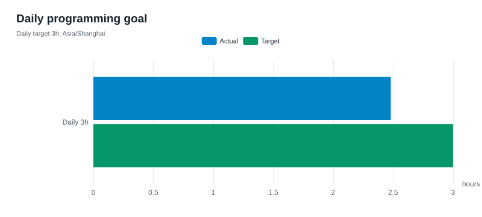

[SVG](charts/goals/current-period.light.wide.svg) · [PNG](charts/goals/current-period.light.wide.png)
