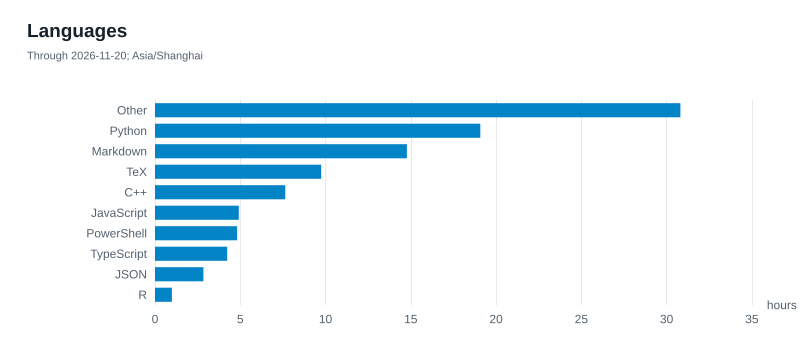

# WakaTime 图表库

为个人主页、博客、GitHub README 和其他网站提供可直接引用的徽章与图表。


[成品预览目录](CATALOG.md) · [全部资源与状态](manifest.json) · [公开统计数据](data/library.json)

`index.html` 提供文字查找、内容与时间范围筛选、浅色／深色、宽版／窄版选择，以及 Markdown／HTML 引用代码复制。GitHub Pages 发布后，可在该仓库的项目站点使用完整目录。

## 成品

| 内容 | 图表 |
| --- | --- |
| 徽章 | Coding、AI Coding、全部活动、各编辑器累计时间 |
| 活动 | 累计概览、每日活动、Coding 与 AI Coding 趋势、年度日历、星期平均活动、日内热力图 |
| 分布 | 语言、编辑器、分类、全部项目、操作系统排行 |
| AI | 新增与删除行数、模型变更量与估算费用排行、模型 Token 排行、每日 Token、会话与提示次数、提示长度 |
| 目标 | WakaTime 每日 3 小时全范围目标的实际活动与目标小时 |

徽章使用紧凑的 `flat` 风格。图表提供浅色和深色 SVG，以及 2 倍分辨率 PNG。清单中的每个条目声明标题、指标说明、统计范围、状态、尺寸和文件地址。缺少权限或指标时生成明确的不可用状态，已取得部分每日记录时保留缺失日期。

## 引用

```markdown


```

```html

```

其他图表通过目录页复制。`config.json` 的 `baseUrl` 决定复制代码使用的公开资源前缀。GitHub Pages 启用后可以改为其项目站点地址。原有 `badges/vscode.svg`、`badges/codex-ai.svg`、`badges/updated.svg` 和版本 1 `stats.json` 地址继续提供其编辑器来源指标。

## 统计口径

- `Code Time` 精确读取 `Coding` 分类，`AI Code Time` 精确读取 `AI Coding` 分类。有效分类数组中未出现的分类按该统计区间无活动处理。
- 编辑器徽章按 WakaTime 返回的编辑器名称分别统计。`Codex Vscode` 可能包含使用相同来源的桌面及 IDE 会话；`Codex CLI` 有独立条目。
- 全部活动包含所有分类与 `Other` 语言。分类时长和编辑器时长使用各自维度。时间采用账号活动合并间隔与 `writes_only` 设置，时区通过配置固定为 `Asia/Shanghai`。
- 每日图使用 `Summaries`，最近日期重新核验。缺失日期保持未知。星期均值的分母是该星期已取得记录的天数，包括明确记录的零活动日。
- 日内图使用 `Durations` 按小时切分。每日会话数沿用来源的按日统计，跨日会话可能出现在多个日期。
- 代码变更展示新增／删除行数。AI 费用为来源按模型价格计算的估算美元费用。缺失的 Token、模型和提示指标保持未知。
- 源更新时间、抓取时间和图表统计区间分别记录。所有生成文件与清单在同一批次发布。

## 更新与权限

`Update WakaTime chart library` 每小时第 17 分钟运行，也支持手动触发。GitHub 调度和图片缓存可能延迟。读取 Token 保存为 Actions Secret `WAKATIME_READ_TOKEN`，采用 OAuth Bearer 认证。

累计统计需要 `read_stats`，每日汇总需要 `read_summaries`，日内区间需要 `read_heartbeats`，目标需要 `read_goals`。实际数据还受账号套餐和采集工具支持情况影响。HTTP 402／403 会登记对应来源不可用。认证错误、网络重试耗尽、源数据损坏或生成失败会使整次更新失败，保留上次发布的文件。

项目统计发布 WakaTime 返回的全部项目原名和时长，项目图表完整列出所有项目，长名称换行、图像高度随项目数量增长。2026-11-15，用户明确要求“项目直接展示所有项目，不需要筛选”，授权该公开范围。文件路径、机器名称、分支、原始会话与读取凭据不进入公开数据。

`dailyGoalSeconds` 为 10800，用于匹配 WakaTime 服务中实际启用的每日 3 小时目标，范围覆盖全部项目、语言、编辑器和每天。账号目标需要在 WakaTime 中配置；读取脚本核对实际目标及最近一期数据。目标缺失或尚无活动数据时显示明确状态。

`historyDays` 控制历史查询范围，默认 366 天。首次分段补齐可访问历史，此后复核最近七天并补查未知日期。可从数据覆盖记录核对实际历史范围。更改时区、计时口径或数据发布配置后重新收集对应历史。

工作分支可以手动运行统计工作流，使用已有 Secret 验证真实接口并上传成品 artifact。自动提交生成结果仅针对 `main` 执行。

## 开发与验证

使用 `.node-version` 中的 Node，运行 `npm ci`、`npm test`。通过本地环境变量提供 Token 后运行 `npm run update`，再运行 `npm run check`。已有 `data/library.json` 时，`npm run build` 可在忽略的 `artifacts/site/` 中重新生成整批图表。

`scripts/` 维护采集、数据校验、图表渲染和发布检查，`site/` 维护目录页面样式与交互。`badges/`、`charts/`、`data/`、根目录清单、目录页面与 `CATALOG.md` 由脚本生成。隔离测试的数据和图表保存在 `artifacts/`。

徽章使用 [badge-maker](https://github.com/badges/shields/tree/master/badge-maker)，图表使用 [Apache ECharts](https://echarts.apache.org/)，PNG 使用 [sharp](https://sharp.pixelplumbing.com/)，SVG 校验使用 [xmldom](https://github.com/xmldom/xmldom)。Linux 生成环境安装 Noto CJK 字体以支持中文标签。

## GitHub Pages 发布

在此仓库 Settings → Pages 中将发布源设为 GitHub Actions。首次成功运行统计更新后，`Publish chart gallery` 会校验并发布同一批公开文件，也支持手动触发。项目站点地址为 `https://susurrium.github.io/wakatime-stats/`。目录复制链接默认使用 Raw 地址，也可通过 `baseUrl` 配置为项目站点地址。

官方数据说明见 [WakaTime API](https://wakatime.com/developers) 与 [计时规则](https://wakatime.com/faq)。
